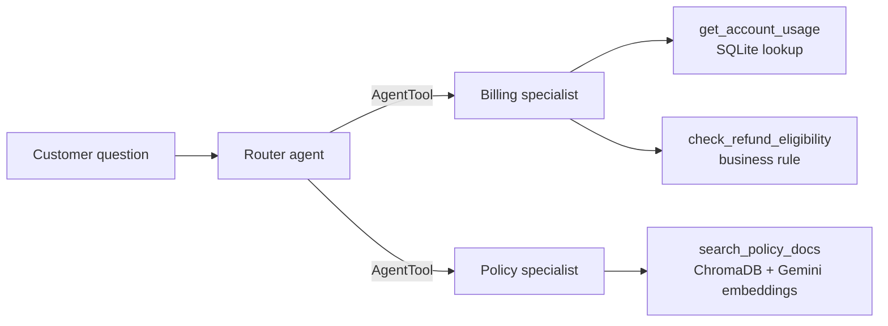

# Telecom Care Triage Agent

A multi-agent customer-care prototype built with Google's Agent Development Kit (ADK) and Gemini. A router agent reads each customer question and hands it to a billing specialist, a policy specialist, or both.

**Status: prototype and demo. All data is fictional, and this is not a production system.** See "What this is and isn't" below.

## What it does

- **Billing questions** ("I had an outage, am I eligible for a refund?"): the billing specialist looks up the account, then chains into a refund-eligibility check using plan type and outage minutes.
- **Policy questions** ("What is your return policy?"): the policy specialist retrieves matching text from a vector store and answers from it instead of from the model's own memory.
- **Ambiguous questions** ("What's the refund policy?"): the router can call both specialists and combine the answers.
- **Refund guardrail:** the billing agent confirms eligibility but does not promise an exact refund amount. Final amounts are left to human review.

## Architecture



## Design decisions

- **Router plus specialists (Agent-as-a-Tool) instead of one large agent.** Each specialist has a short prompt and a small tool list, which reduces wrong-tool calls on similarly worded questions. A new domain can be added without touching the existing agents.
- **The billing lookup is a fixed, parameterized SQL query exposed as a tool.** The model supplies an account ID, not SQL. Exact-match lookups are not RAG.
- **Policy answers use RAG.** Documents are embedded with `gemini-embedding-001`, stored in ChromaDB, retrieved by similarity, and passed to the model as context.
- **Account IDs are normalized** (`strip` and `upper`) before the lookup. A test run found that lowercase IDs failed to match.

## What this is and isn't

| Real in this repo | Not yet built |
|---|---|
| Router and two specialists with working tools | Authentication beyond an optional shared access code |
| Chained tool calls (usage lookup, then eligibility rule) | Persistent sessions (sessions are in memory and reset on restart) |
| RAG over a small document set | Ingestion of real documents (PDF extraction, chunking, tables) |
| Streamlit demo with a routing and tool trace | Structured logging, monitoring and cost tracking |
| | Automated evaluation in this repo (a 9-case manual check was run in a notebook during development) |
| | Code-level enforcement of the refund guardrail (it is currently an instruction in the agent prompt) |

The policy knowledge base is three sentences and the billing table has two accounts. The architecture is the real part. The scale is not.

## Run locally

```bash
python -m venv .venv
.venv\Scripts\activate          # Windows
pip install -r requirements.txt
```

Create `telecomtriage/.env` (gitignored):

```
GOOGLE_GENAI_USE_VERTEXAI=FALSE
GOOGLE_API_KEY=your-gemini-api-key
```

Then either:

```bash
streamlit run app.py     # demo UI
adk web                  # ADK's developer UI, run from this folder
```

On first start the agent creates `billing.db` and `chroma_db_recap/` from the mock data in `telecomtriage/agent.py`.

## Deploy the demo

Streamlit Community Cloud works: point it at `app.py`, choose Python 3.12 in the advanced settings, and add the secrets from `.streamlit/secrets.toml.example`. Set `APP_PASSWORD` so only people you share the code with can use it, and put a spending cap on the API key.

## Roadmap

1. Move the guardrail from the prompt into code: block or flag any response that states a refund amount.
2. Add logging for every routing decision, tool call and retrieval.
3. Add the evaluation script to the repo and run it automatically on each change.
4. Ingest real PDFs with chunking, table handling and source citations.
5. Deploy the container (see `Dockerfile`) to a managed service behind real authentication.
